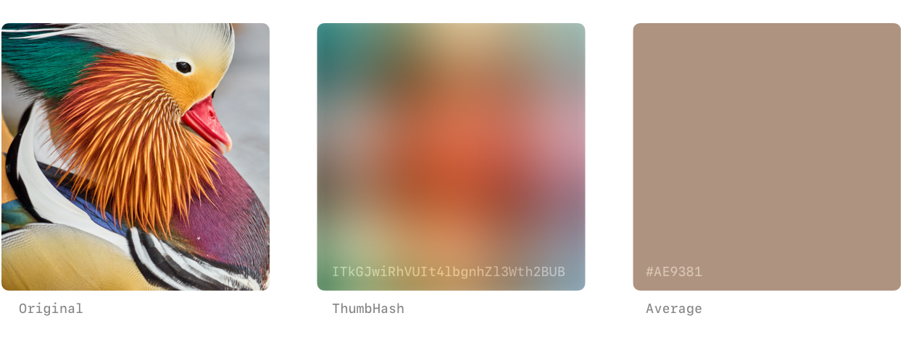

# WP Thumbhash

[](https://packagist.org/packages/hirasso/wp-thumbhash)
[](https://github.com/hirasso/wp-thumbhash/actions/workflows/ci.yml)
<!--[](https://github.com/hirasso/wp-thumbhash/blob/main/LICENSE)-->

**A WordPress plugin that automatically generates and displays thumbhash placeholders for your lazy-loaded images 🦦**



## Docs

- [**🔌 Installation**](./docs/INSTALLATION.md)
- [**💡 Usage**](./docs/USAGE.md)
- [**📚 Changelog**](./CHANGELOG.md)

## Dependencies

Runtime dependencies are prefixed into `vendor-prefixed/` by [Strauss](https://github.com/BrianHenryIE/strauss) and committed. Composer serves the git tag's archive, so committing them makes a composer install and the release zip the same directory. Regenerate with:

```shell
composer prefix
```

- **Nothing that gets prefixed may live in `require`.** Runtime dependencies belong in `require-dev` and in `extra.strauss.packages`. Anything in `require` would be installed _unprefixed_ into the vendor folder of every site using this plugin.
- **`src/` references the prefixed namespaces directly** (`Hirasso\WPThumbhash\Vendor\...`), in development as well as in a release.

After changing a dependency, verify the committed output (also runs in CI and before a release):

```shell
config/cli/cli.js verify:prefixed
```

## Attribution

**wp-thumbhash** draws heavy inspiration from the [Statamic Placeholder Images](https://github.com/daun/statamic-placeholders) addon, even using the same hero image with permission. Also, special thanks to [Evan Wallace](https://github.com/evanw/thumbhash) for the original ThumbHash algorithm.
